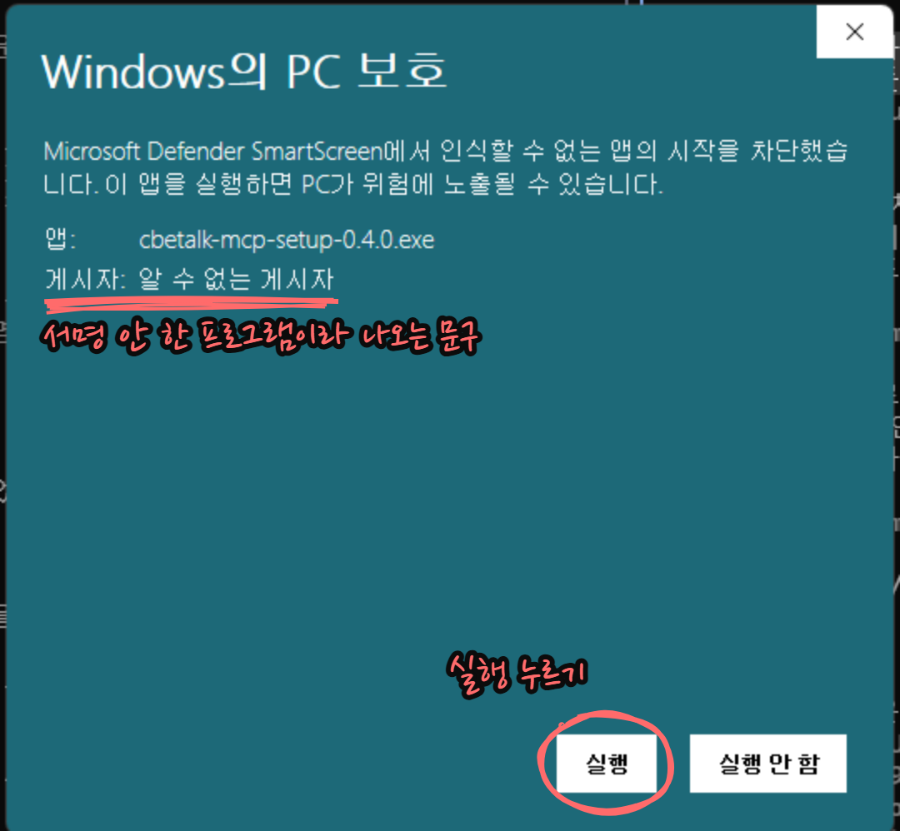
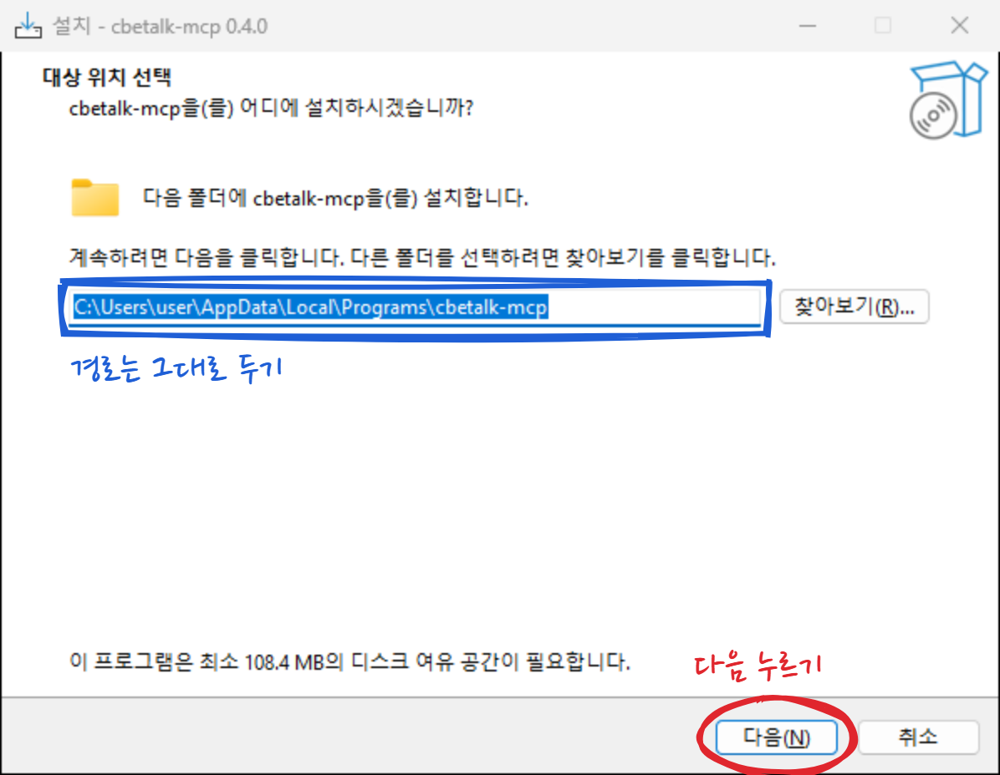
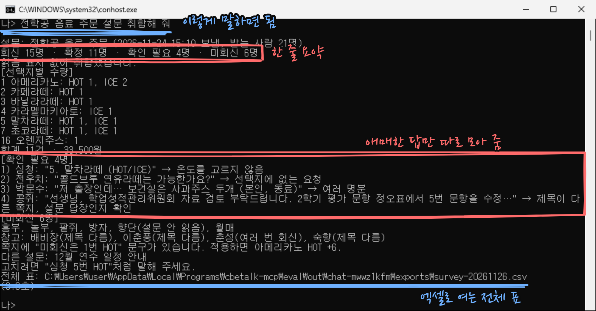

<div align="center">

<a href="https://cbetalk-mcp.netlify.app"></a>

# cbetalk-mcp

**충북소통메신저(CBE Talk) 쪽지를 AI에게 맡기는 도우미**

안 읽은 쪽지 확인 · 설문 회신 취합 · 받는 사람 찾기 · 쪽지 초안 쓰기를 말 한마디로

<br>

<a href="https://github.com/jkf87/cbetalk-mcp-installer/releases/download/v0.4.0/cbetalk-mcp-setup-0.4.0.exe"></a>
&nbsp;
<a href="https://cbetalk-mcp.netlify.app"></a>


</div>

<br>

## 무엇을 할 수 있나요

| | |
|---|---|
| **쪽지 확인** | "안 읽은 쪽지 보여 줘", "오늘 받은 쪽지 중에 회의 관련만" |
| **설문 취합** | "전학공 음료 주문 설문 취합해 줘" → 수량·금액 합계, 애매한 답, 미회신자를 한 번에 |
| **사람 찾기** | "교무부 이몽룡 선생님 찾아 줘" |
| **쪽지 초안** | "3번 쪽지에 확인했다고 답장 써 줘" → 미리보기를 보고 사람이 보내기 |

쓰는 방법은 두 가지입니다.

- **AI 도구에서**: Claude Code, Codex, Antigravity(agy). 설치할 때 체크만 하면 자동으로 등록됩니다.
- **이 PC 안의 작은 AI(로컬 2B)로**: 쪽지 내용이 외부 AI 서버로 나가지 않습니다. CPU만으로 돌고, 한 번 답하는 데 3~6초 걸립니다.

<br>

## 시작하기 전에: AI 에이전트가 필요합니다

cbetalk-mcp는 혼자 돌아가는 앱이 아닙니다. **Claude Code, Codex, Antigravity 같은 AI 에이전트**에 "메신저 쪽지를 다루는 손"을 붙여 주는 도구입니다. 말을 알아듣고 어떤 쪽지 기능을 쓸지 고르는 건 에이전트가 합니다.

| 상황 | 이렇게 |
|---|---|
| Claude Code·Codex를 이미 쓴다 | 그대로 설치로 넘어갑니다. 설치 화면에서 체크하면 자동으로 연결됩니다. |
| **에이전트가 없다** | **무료인 Google Antigravity**를 먼저 설치합니다. 아래 순서. |
| 인터넷 AI 없이 쓰고 싶다 | 로컬 2B 모델로 씁니다. 정해진 일(쪽지 목록·설문 취합 등)만 하고 답이 조금 느립니다. |

### 무료 Google Antigravity 설치

개인 Google 계정으로 무료로 쓸 수 있습니다(사용량 한도 있음). 설치 파일이 자동으로 연결하는 것은 명령 창용 **`agy`** 입니다.

1. PowerShell을 열고 한 줄을 붙여 넣습니다.
   ```powershell
   irm https://antigravity.google/cli/install.ps1 | iex
   ```
2. PowerShell에서 `agy`를 한 번 실행해 Google 계정으로 로그인합니다.
3. 그다음 cbetalk-mcp를 설치합니다. **에이전트를 먼저 깔아야 자동으로 연결됩니다.**

<a href="https://antigravity.google/download"></a>
&nbsp;<sub><a href="https://antigravity.google/docs/getting-started?tab=cli">공식 설치 안내</a></sub>

<details>
<summary><b>cbetalk-mcp를 먼저 깔았다면</b></summary>
<br>

설치 파일을 한 번 더 실행해 에이전트를 체크하거나, PowerShell에서 아래 명령으로 연결합니다(`agy` 자리에 `claude`, `codex`, `all`도 됩니다).

```powershell
& "$env:LOCALAPPDATA\Programs\cbetalk-mcp\node\node.exe" "$env:LOCALAPPDATA\Programs\cbetalk-mcp\scripts\register-clients.mjs" add agy
```
</details>

<br>

## 내려받을 때: Edge가 다운로드를 막는다면

> [!TIP]
> **"cbetalk-mcp-setup-0.4.0.exe은(는) 일반적으로 다운로드되지 않습니다"** 가 뜨면, 내려받은 사람이 아직 적은 새 파일이라 Edge가 한 번 더 확인하는 것입니다. 학교 PC에서 자주 생깁니다.

1. 다운로드 목록에서 파일 이름에 마우스를 올리고 **`…`(추가 작업)** 을 누릅니다. 목록이 안 보이면 <kbd>Ctrl</kbd>+<kbd>J</kbd>.
2. **유지**를 누릅니다.
3. "이 앱이 디바이스에 해를 끼칠 수 있습니다" 창에서 **추가 정보 표시**를 펼치고 **그래도 계속**을 누릅니다.

Chrome에서는 다운로드 목록의 **유지**(또는 **그래도 다운로드**)를 누르면 됩니다.

<br>

## 처음 실행할 때: 파란 경고 창 넘기기

> [!IMPORTANT]
> 코드 서명 인증서를 붙이지 않은 프로그램이라 **"Windows의 PC 보호"** 창이 뜹니다. 바이러스가 발견됐다는 뜻은 아닙니다.
> **추가 정보**는 버튼이 아니라 본문 바로 아래의 **작은 밑줄 글씨**입니다. 여기서 많이 막힙니다.

<table>
  <tr>
    <th width="50%">① 본문 아래 <code>추가 정보</code> 글씨를 누릅니다</th>
    <th width="50%">② 새로 생긴 <code>실행</code>을 누릅니다</th>
  </tr>
  <tr>
    <td></td>
    <td></td>
  </tr>
  <tr>
    <td><b>실행 안 함</b>을 누르면 설치가 취소됩니다.</td>
    <td>"게시자: 알 수 없는 게시자"는 서명을 안 해서 나오는 문구입니다.</td>
  </tr>
</table>

<details>
<summary><b>'실행' 버튼이 끝까지 안 나온다면</b></summary>
<br>

학교 PC 관리 정책이나 Windows의 '스마트 앱 컨트롤'이 켜져 있으면 실행 버튼 없이 막힙니다.

1. 설치 파일을 **오른쪽 클릭 → 속성**
2. 아래쪽 **보안: 차단 해제**에 체크 → **확인**
3. 다시 실행

그래도 막히면 학교 정보 담당 선생님께 문의하세요.
</details>

<br>

## 설치 순서

<table>
  <tr>
    <td width="33%" valign="top"><b>③ 설치 위치는 그대로 두고 다음</b><br><sub>내 사용자 폴더에 깔려서 관리자 비밀번호를 묻지 않습니다.</sub></td>
    <td width="33%" valign="top"><b>④ 쓸 AI 도구를 체크</b><br><sub>이 PC에 깔린 도구만 보입니다. 로컬 2B 모델(1.4GB)은 선택입니다.</sub></td>
    <td width="33%" valign="top"><b>⑤ 고른 항목을 확인하고 설치</b><br><sub>끝나면 시작 메뉴 <code>cbetalk-mcp → 사용 안내</code>가 생깁니다.</sub></td>
  </tr>
  <tr>
    <td></td>
    <td></td>
    <td></td>
  </tr>
</table>

<br>

## 이렇게 씁니다

충북소통메신저가 켜져 있고 로그인돼 있어야 합니다. AI 도구는 설치 뒤 한 번 새로 실행하세요.

| 도구 | 준비 | 이렇게 말해 보세요 |
|---|---|---|
| **Claude Code** | `/mcp`에서 `cbetalk`가 보이면 끝 | `안 읽은 쪽지 보여 줘` |
| **Codex** | 도구를 처음 쓸 때 허용 | `3번 쪽지 답장 초안 써 줘` |
| **Antigravity (agy)** | 허용 목록에 `mcp(cbetalk/*)`를 넣으면 매번 묻지 않음 | `지난주 보낸 쪽지에서 연수 일정 찾아 줘` |

### 로컬 2B로 설문 취합

시작 메뉴의 **로컬 모델 받기**(처음 한 번, 1.4GB) → **로컬 모델 대화**. 메신저에 닿지 않는 **연습 모드**도 있습니다.

<p align="center"><br><sub>연습 모드에서 설문 회신을 취합한 화면 (이름은 연습용 가명)</sub></p>

<br>

## 믿고 맡길 수 있게

| | |
|---|---|
| **보내기 전에 미리보기** | 보내기·답장·삭제는 기본이 미리보기입니다. 내용을 보고 "보내"라고 해야 실제로 나갑니다. |
| **로컬 AI는 보내지 못함** | 로컬 모델에는 발송 도구가 없습니다. Windows 확인 창에서 사람이 [보내기]를 눌러야 나갑니다. |
| **읽음 표시 조심** | 목록 보기와 설문 취합은 미리보기만 씁니다. 안 읽은 쪽지를 열 때는 한 번 더 묻습니다. |
| **숫자는 프로그램이 계산** | 설문 수량·금액은 AI가 고쳐 쓰지 않고, 계산한 그대로 화면에 나옵니다. |

<br>

## 받은 파일 확인 · 지우기

<details>
<summary><b>받은 파일이 원본 그대로인지 확인하기 (SHA256)</b></summary>
<br>

```powershell
Get-FileHash "$env:USERPROFILE\Downloads\cbetalk-mcp-setup-0.4.0.exe"
```

릴리스의 `SHA256SUMS.txt` 값과 같으면 됩니다.

v0.4.0: `75d44e2c0bb9bd826c105aa5efb32ee7d9d591f638c36a986976cd725b98214e`
</details>

<details>
<summary><b>지우기</b></summary>
<br>

**설정 → 앱 → 설치된 앱**에서 `cbetalk-mcp`를 제거합니다. AI 도구에 등록한 `cbetalk`도 함께 지워집니다. 받은 로컬 모델(`%LOCALAPPDATA%\cbetalk-mcp`)과 쪽지 백업 폴더는 남겨 둡니다.
</details>

<details>
<summary><b>설치 파일에 들어 있는 것</b></summary>
<br>

- cbetalk-mcp 서버와 실행 스크립트
- Node.js 실행 파일 (`node\node.exe`, 라이선스 `node\LICENSE`)
- 로컬 2B 모델은 들어 있지 않습니다. 설치 중에 고르거나 나중에 받습니다 (llama.cpp b10883 + Qwen3.5-2B Q4_K_M).
</details>

<br>

<div align="center">

**제작자: 코난쌤**

<a href="https://www.youtube.com/@conanssam"></a>

<sub><a href="https://cbetalk-mcp.netlify.app">안내 페이지</a> · <a href="https://github.com/jkf87/cbetalk-mcp-installer/releases">모든 버전</a></sub>

</div>
